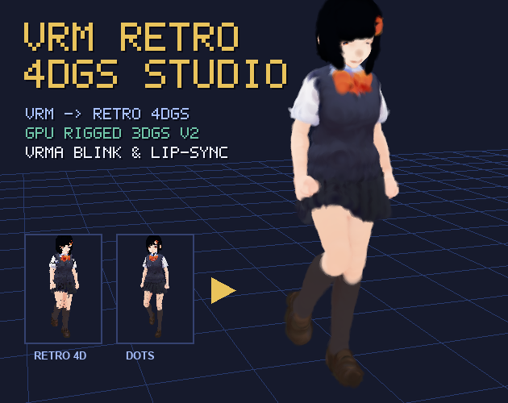

# VRM RETRO 4DGS STUDIO

[English](README.md)



VRM アバター（0.x / 1.0）や GLB を開いて **ガウシアンスプラット（粒）** にし、モーション・まばたき・口パク付きで動かせるツールです。
Pyxel 3 のレトロ表示（ディザの粒）と WebGL2 のなめらかな表示を並べて見られます。できたものはスプラットのファイルや、1 枚の HTML として書き出せます。

[VRM RETRO VIEWER](https://github.com/harukaappscreate/vrm-retro-viewer)、[VRM Motion Studio](https://github.com/harukaappscreate/vrm-motion-studio)、[VRM RETRO MAKER](https://github.com/harukaappscreate/vrm-retro-maker)、[VRM RETRO PAPERCRAFT](https://github.com/harukaappscreate/vrm-retro-papercraft) の兄弟ツールです。一覧: [VRM RETRO](https://harukaappscreate.github.io/vrm-retro/)

ファイルはどこにも送られません。読み込み・粒の生成・書き出しは、ブラウザ（または手元のパソコン）の中だけで行います。

## ここでいう「4DGS」について

論文で「4DGS」というと、ふつうは動く場面を撮った **動画から学習した** ガウシアンスプラットのことです。このツールは学習をせず、動画も使いません。

1. **サンプリング.** アバターのメッシュの表面に粒を置きます。色はテクスチャから、大きさと向きは置いた三角形から決めます。顔のパーツ（目・口・眉）は別に粒を置いて捨てないので、顔が崩れません。服の下に隠れる体の粒は捨てます。
2. **リギング.** 粒はそれぞれ、置いた場所のボーンの重みと表情モーフを持ちます。なのでボーンと表情は、メッシュと同じように粒を動かします（WebGL2 表示では GPU スキニングと GPU モーフ）。
3. **ベイク.** 「Bake 4DGS」で、動く粒を 1 フレームずつ記録します（15 / 24 / 30 fps）。この「3D の粒＋時間」の連番を、このツールでは 4DGS と呼んでいます。

論文の言葉でいえば **リグ付き（アニメーション可能な）3DGS** に近いものです。読み込んだアバターをそのまま見せるもので、メッシュにない細部を作り出すものではありません。

## できること

- **2 つのプレビュー.** Pyxel レトロ表示: 4DGS / 分割（メッシュ | 粒）/ メッシュ / ドット、ディザかベタ塗り。WebGL2 表示: ガウシアンかドット、ベイクしたフレームのなめらかな再生。
- **モーション.** CC0 のモーション 231 種を内蔵。自分の `.vrma` や `.fbx` もドロップで読めます。
- **表情.** VRM 1.0 の `VRMC_vrm.expressions` と VRM 0.x の `blendShapeMaster`（blink、aa / ih / ou / ee / oh、happy、angry、sad、relaxed、surprised など）、VRMA の表情トラック（`LINEAR`、`CUBICSPLINE`、`STEP`）を読みます。Auto Blink と Expr Test はどのモーションでも使えます。内蔵の「Wink & Lip-Sync Demo [EXPR]」は `app/expr_demo.vrma` です。
  同梱の `web/sample.vrm` は軽くするためにモーフを外してあるので、表情は表情付きの VRM で試してください。
- **背景（WebGL2 表示）.** 写真背景（Photo BG）、カメラ背景（Camera BG）、床に合わせる高さ（Height Y）。
- **書き出し.**
  - **Single .HTML**: オフラインで開ける 1 枚のページ（CDN なし）。動く粒・表情・カメラ／写真背景つき
  - **4DGS .ZIP**: `sequence.r3dg` + `manifest.json` + フレームごとの Y-down `.splat`
  - **.SPLAT / .PLY**: 1 フレーム、正立（Y-down）。ほかの 3DGS ビューア向け

### カメラ背景について

ブラウザは安全なページでしかカメラを使わせません。カメラ背景は、書き出した **Single .HTML** と、GitHub Pages などの HTTPS のページで使えます。
itch.io のページの中では **使えません**（ゲームの枠にカメラの許可が渡らないため）。写真背景はどこでも使えます。

## ライセンスの確認

ほかの VRM RETRO のツールと同じく、改変を禁止しているアバターは読み込みません:
VRM 1.0 の `modification: prohibited`（項目がないときも）、VRM 0.x の `Redistribution_Prohibited` と `*_ND` のライセンス。
ステータス行に `ERR: LICENSE: NO MODIFICATION (...)` と出て、開いていたモデルはそのまま残ります。
それ以外のアバターはライセンスがページに表示されます。書き出したものを使ったり配ったりするときは、そのライセンスに従ってください。

## 操作

マウス: **左ドラッグ** 回転、**右ドラッグ**（中ドラッグ。WebGL2 では **Shift + 左ドラッグ** も）キャラ移動、**ホイール** ズーム、**R** リセット。

デスクトップのキー: SPACE 再生／一時停止、`,` `.` コマ送り、M / N 次／前のモーション、V 表示切替、G ブラシ、`[` `]` 粒の大きさ、C 粒の数（8K〜50K）、F ベイクの fps、B ベイク、H ヘルプ、
1 .PLY、2 .SPLAT、3 .ZIP、4 .HTML（`exports/` に保存）。

## 手元で動かす

Python 3 と Pyxel 3 が要ります（`pip install pyxel numpy pillow`）。

```bash
python app/main.py                 # 窓に .vrm / .glb（または .vrma / .fbx モーション）をドロップ
python app/main.py avatar.vrm      # ファイルを直接開く
```

**ブラウザ版:** `web/index.html` と `web/vrm_retro_4dgs.pyxapp`。`web` フォルダをサーバーで配って（たとえばその中で `python -m http.server`）開きます。
`.pyxapp` と itch.io 用 zip を作り直すには `python tools/build_web.py`。

## 確認したこと

- Pyxel 3.0.4 デスクトップ: `web/sample.vrm` を読み込める。同じファイルを `modification: prohibited` に書き換えたものは、上のメッセージで読み込みを断る。
- ライセンス判定を VRM 1.0 / 0.x のメタデータで確認（prohibited、項目なし、`CC_BY_ND`、`CC_BY_NC_ND`、`Redistribution_Prohibited`、`CC0`、`Other`、VRM メタなし）。
- itch.io 上のブラウザ版（カメラ背景は上のとおり使えない）。

## ファイル

| ファイル | 中身 |
|---|---|
| `app/main.py` | アプリ本体（Pyxel 表示、モーション、ベイク、書き出し、ページとのやりとり） |
| `app/splat_engine.py` | メッシュ → 粒のサンプリング、スキニングとモーフ、`.ply` / `.splat` / `.zip` / 1 枚 HTML の書き出し |
| `app/vrm_io.py`、`app/vrma_io.py`、`app/fbx_io.py` | VRM / GLB、VRMA と FBX モーションの読み込み、ライセンス確認 |
| `app/motions.npz` | 内蔵モーション |
| `app/expr_demo.vrma` | ウインクと口パクのデモモーション |
| `web/` | `index.html`（スタジオのページと WebGL2 表示）、`vrm_retro_4dgs.pyxapp`、`sample.vrm` |
| `docs/` | カバー画像とスクリーンショット |
| `tools/build_web.py` | ブラウザ版を作る |

## クレジット

- モーション: Quaternius Universal Animation Library 1 & 2、KayKit Character Animations（Kay Lousberg）。すべて CC0、open-vrma 経由
- `web/sample.vrm`: 千駄ヶ谷 渋（VRoid の CC0 サンプルモデル、VRM データは coati 氏）。VRM RETRO VIEWER 用に軽くしたもの
- [Pyxel](https://github.com/kitao/pyxel)（Takashi Kitao 氏、MIT License）、Pyodide（MPL-2.0）、NumPy（BSD-3-Clause）、Pillow（MIT-CMU）

## ライセンス

MIT License（haruka_apps）。LICENSE を見てください。

このツールと、ツールで作ったものは「現状のまま」提供され、いかなる保証もありません。
読み込む VRM のライセンスを守るのは使う人の責任です。
