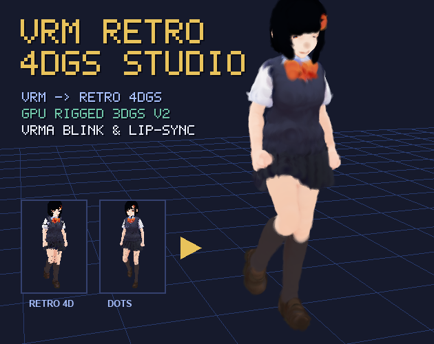

# VRM RETRO 4DGS STUDIO

[日本語](README.ja.md)



Open a VRM avatar (0.x or 1.0) or a GLB, turn it into **Gaussian splats**, and play it with motions, blinking and lip-sync.
Look at it two ways side by side: a retro Pyxel 3 view (dithered dots) and a smooth WebGL2 view. Then export it as splat files or as one HTML page.

A sibling of [VRM RETRO VIEWER](https://github.com/harukaappscreate/vrm-retro-viewer), [VRM Motion Studio](https://github.com/harukaappscreate/vrm-motion-studio), [VRM RETRO MAKER](https://github.com/harukaappscreate/vrm-retro-maker) and [VRM RETRO PAPERCRAFT](https://github.com/harukaappscreate/vrm-retro-papercraft). All tools: [VRM RETRO](https://harukaappscreate.github.io/vrm-retro/).

Your file is never uploaded. Reading, sampling and exporting happen inside your browser (or your own computer).

## What "4DGS" means here

In research papers, "4DGS" usually means Gaussian splats **learned from video** of a moving scene. This tool learns nothing and uses no video.

1. **Sampling.** Splats are placed on the surface of the avatar's mesh. Each one takes its colour from the texture and its size and direction from the triangle it sits on. The face parts (eyes, mouth, brows) are sampled on their own and never dropped, so the face stays readable. Body splats hidden under clothes are dropped.
2. **Rigging.** Each splat keeps the bone weights and expression morphs of the place it came from, so bones and expressions move it the same way they move the mesh (GPU skinning and GPU morphs in the WebGL2 view).
3. **Baking.** "Bake 4DGS" records the moving splats frame by frame (15, 24 or 30 fps). That sequence, 3D splats over time, is what this tool calls 4DGS.

This is closer to what papers call **rigged (animatable) 3DGS**. It shows the avatar you load; it does not rebuild details that are not in the mesh.

## Features

- **Two previews.** Pyxel retro view: 4DGS / Split (mesh | splats) / Mesh / Dots, dither or solid brush. WebGL2 view: Gaussian or dot style, smooth playback of the baked frames.
- **Motions.** 231 CC0 motions built in. Drop your own `.vrma` or `.fbx` motion.
- **Expressions.** Reads VRM 1.0 `VRMC_vrm.expressions` and VRM 0.x `blendShapeMaster` (blink, aa / ih / ou / ee / oh, happy, angry, sad, relaxed, surprised ...) and VRMA expression tracks (`LINEAR`, `CUBICSPLINE`, `STEP`). Auto Blink and Expr Test work with any motion. The built-in "Wink & Lip-Sync Demo [EXPR]" is `app/expr_demo.vrma`.
  The bundled `web/sample.vrm` has no morphs (it was made smaller), so try expressions with your own VRM.
- **Backgrounds (WebGL2 view).** Photo BG, Camera BG, and Height Y to put the avatar on the floor.
- **Export.**
  - **Single .HTML**: one offline page (no CDN) with the moving splats, expressions and Camera / Photo BG
  - **4DGS .ZIP**: `sequence.r3dg` + `manifest.json` + one Y-down `.splat` per frame
  - **.SPLAT / .PLY**: one frame, upright (Y-down), for other 3DGS viewers

### Camera BG

Browsers allow the camera only on secure pages. Camera BG works in the exported **Single .HTML** and on HTTPS pages such as GitHub Pages.
It does **not** work inside the itch.io page (the game frame does not get camera permission). Photo BG works everywhere.

## Licence check

Avatars whose license forbids modification are refused, the same as in the other VRM RETRO tools:
VRM 1.0 `modification: prohibited` (or missing), VRM 0.x `Redistribution_Prohibited` and the `*_ND` licenses.
The status line shows `ERR: LICENSE: NO MODIFICATION (...)` and the model that was open stays open.
For the others, the license is shown on the page; follow it when you use or share what you export.

## Controls

Mouse: **left drag** orbit, **right drag** (or middle drag; **Shift + left drag** in WebGL2) move the avatar, **wheel** zoom, **R** reset.

Desktop keys: SPACE play / pause, `,` `.` step, M / N next / previous motion, V view, G brush, `[` `]` splat size, C splat count (8K–50K), F bake fps, B bake, H help,
1 .PLY, 2 .SPLAT, 3 .ZIP, 4 .HTML (saved in `exports/`).

## Run it yourself

You need Python 3 and Pyxel 3 (`pip install pyxel numpy pillow`).

```bash
python app/main.py                 # then drop a .vrm / .glb (or a .vrma / .fbx motion) on the window
python app/main.py avatar.vrm      # or open a file directly
```

**Browser:** `web/index.html` with `web/vrm_retro_4dgs.pyxapp`. Serve the `web` folder (for example `python -m http.server` inside it) and open it.
To rebuild the `.pyxapp` and the itch.io zip: `python tools/build_web.py`.

## Checked

- Pyxel 3.0.4 desktop: `web/sample.vrm` loads; the same file with `modification: prohibited` is refused with the message above.
- The licence rule with VRM 1.0 / 0.x metadata (prohibited, missing, `CC_BY_ND`, `CC_BY_NC_ND`, `Redistribution_Prohibited`, `CC0`, `Other`, no VRM meta).
- Browser version on itch.io (Camera BG off there, as described above).

## Files

| File | What it is |
|---|---|
| `app/main.py` | the app (Pyxel view, motions, bake, export; talks to the page) |
| `app/splat_engine.py` | mesh → splat sampling, skinning and morphs, `.ply` / `.splat` / `.zip` / single HTML export |
| `app/vrm_io.py`, `app/vrma_io.py`, `app/fbx_io.py` | reading VRM / GLB, VRMA and FBX motions, the licence check |
| `app/motions.npz` | the bundled motions |
| `app/expr_demo.vrma` | the wink and lip-sync demo motion |
| `web/` | `index.html` (the studio page and WebGL2 view), `vrm_retro_4dgs.pyxapp`, `sample.vrm` |
| `docs/` | cover and screenshots |
| `tools/build_web.py` | builds the browser version |

## Credits

- Motions: Quaternius Universal Animation Library 1 & 2 and KayKit Character Animations (Kay Lousberg), all CC0, via open-vrma
- `web/sample.vrm`: Sendagaya Shibu, a CC0 sample model of VRoid (VRM data by coati), made smaller for VRM RETRO VIEWER
- [Pyxel](https://github.com/kitao/pyxel) by Takashi Kitao (MIT License); Pyodide (MPL-2.0), NumPy (BSD-3-Clause), Pillow (MIT-CMU)

## License

MIT License (haruka_apps). See LICENSE.

This tool and everything it makes are provided "AS IS", without warranty of any kind.
You are responsible for following the license of the VRM you load.
